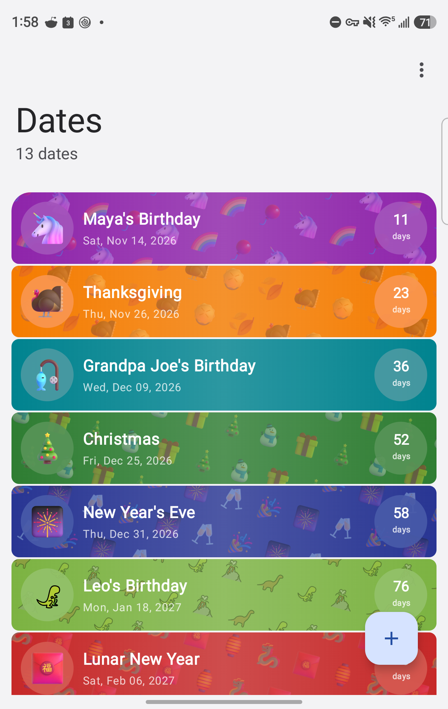
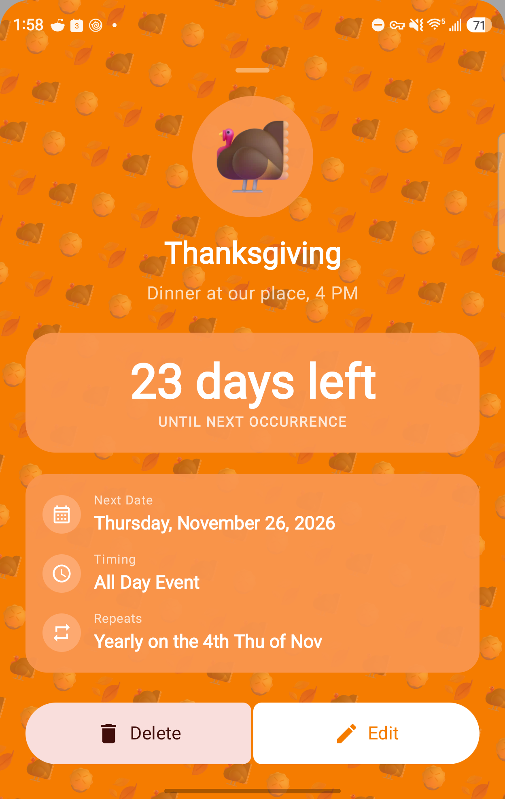
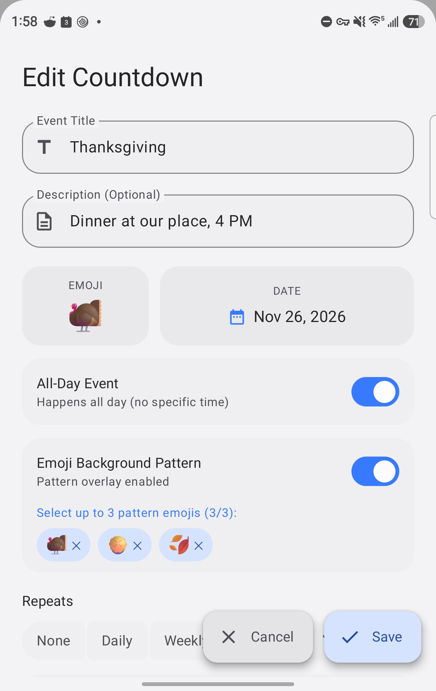
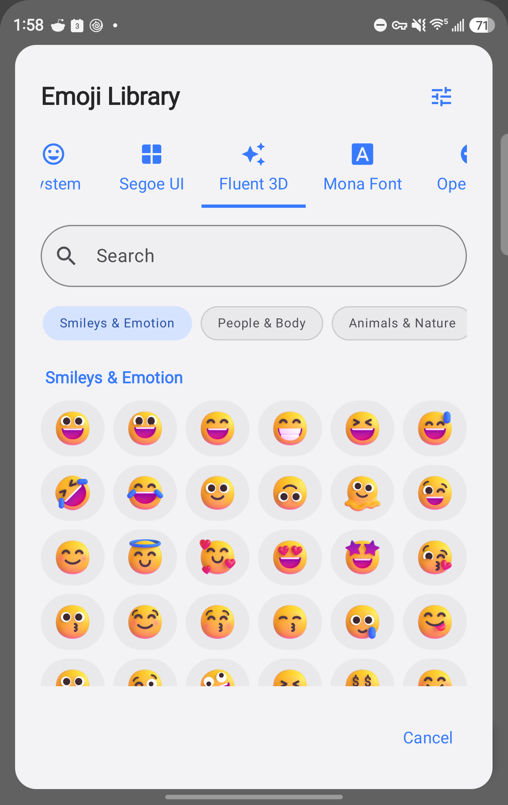
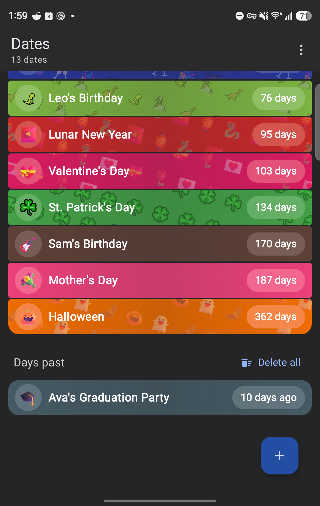

# Dates

Countdowns for the days that matter — birthdays, holidays, trips and deadlines — with big
emoji, colorful cards and home screen widgets. Built with Jetpack Compose and Material 3
Expressive for Android.

<p>
  
  
  
  
  
</p>

## Features

- **Countdowns that repeat.** Daily, weekly, monthly and yearly dates, plus custom rules: every
  N days, weeks, months or years; several weekdays ("every Tue and Thu"); or the nth weekday
  ("the 4th Thursday of November"). Days are counted by the calendar, so tomorrow is always
  "1 day".
- **Five emoji styles.** System, Fluent 3D, OpenMoji, Mona pixel font and Segoe UI, with search,
  Unicode categories and skin tones. Pick a default style and existing dates restyle to match.
- **Emoji wallpapers and colors.** Up to three emoji tiled behind a card, and any card color.
- **Layouts and themes.** Expanded, compact and small lists; light, dark or system theme; sort by
  days left or alphabetically. Past one-time dates move to a "Days past" section.
- **Home screen widgets.** An upcoming list, the next date, or a date you choose, in wide and
  square sizes, each with its own theme and layout.
- **Calendar import.** Bring in events from any calendar on the phone. The emoji in a title
  becomes the date's emoji, and dates already in the list are skipped.
- **Two-way Google Calendar sync.** See below.

## Install

Download `Dates-1.0.apk` from the [latest release](https://github.com/wylew/Dates/releases/latest)
and open it on your phone. Android will ask you to allow installs from the app you opened it
with (your browser or file manager). Requires Android 8.0 or newer.

If you installed a development build of Dates before, uninstall it first: release builds are
signed with a different key, so Android won't install one over the other. With calendar sync on,
your dates come back from the calendar after reinstalling.

## Calendar sync

Dates can keep your dates in a calendar of your Google account. That backs them up, puts them on
your other devices, and lets you add dates from [calendar.google.com](https://calendar.google.com).

1. On the web, create a calendar for your dates (Settings → Add calendar → Create new calendar),
   for example "Dates". Android doesn't let apps create calendars in a Google account, and a
   calendar of its own keeps dates apart from your everyday events.
2. In the app, open ⋮ → **Calendar sync** and pick that calendar.

From then on, new dates, edits and deletions go both ways. Pull down on the list to sync right
away. How it works:

- The event title is the emoji and the title, e.g. "🎂 Mom". Change the emoji on the web and the
  app picks it up, drawn in the same emoji style.
- The event description ends with one coded line under a "Dates app" label. It holds the emoji
  style, wallpaper and exact card color. Leave it in place; your own notes above it are kept.
- Google Calendar events can only use Google's 11 event colors, so the calendar shows the closest
  one. The exact color lives in the coded line.
- Only fields the app owns are written. Locations, guests, reminders, end dates and skipped
  occurrences are left alone, and a repeat rule is only rewritten when you change the repeat in
  the app.
- If more than half of your synced dates disappear from the calendar at once, Dates writes them
  back instead of deleting them, in case the calendar was emptied by mistake.
- Google may add your calendar's default notifications to new events. Turn those off in the
  calendar's settings if you don't want them.

## Build from source

You need the Android SDK and JDK 17 or newer (Android Studio includes both).

```sh
./gradlew assembleDebug        # app/build/outputs/apk/debug/app-debug.apk
./gradlew testDebugUnitTest    # unit tests
```

Release builds are signed with a key kept outside the repository. Put its details in
`~/.gradle/gradle.properties`:

```properties
DATES_RELEASE_STORE_FILE=/path/to/dates-release.jks
DATES_RELEASE_STORE_PASSWORD=…
DATES_RELEASE_KEY_ALIAS=dates
DATES_RELEASE_KEY_PASSWORD=…
```

then run `./gradlew assembleRelease`. Without those properties the release build is unsigned.

The emoji assets are generated by the scripts in `tools/` (each script's header explains its
source and usage).

## Privacy

Your dates are stored on your phone. Calendar access is only used when you import events or turn
on calendar sync, and synced dates go only to the calendar you pick. The app has no accounts,
analytics or ads.

## Credits and licenses

The app's About screen (⋮ → About) shows each credit with its full license text, also found in
[`app/src/main/assets/licenses`](app/src/main/assets/licenses).

### Emoji artwork

| Artwork | Copyright | License |
|---|---|---|
| [Fluent Emoji](https://github.com/microsoft/fluentui-emoji) (3D images, resized for the app) | © Microsoft Corporation | [MIT License](app/src/main/assets/licenses/fluentui-emoji-mit.txt) |
| [OpenMoji](https://openmoji.org) | © OpenMoji contributors, HfG Schwäbisch Gmünd | [CC BY-SA 4.0](app/src/main/assets/licenses/cc-by-sa-4.0.txt) |
| [Mona12 Color Emoji](https://monadabxy.com/) | © 2025 Monad ABXY | [SIL Open Font License 1.1](app/src/main/assets/licenses/mona12-ofl-1.1.txt) |
| [Segoe UI Emoji](https://learn.microsoft.com/typography/font-list/segoe-ui-emoji) (SVG renderings) | © Microsoft Corporation. All rights reserved. | Proprietary, not open source |

OpenMoji attribution: *All emojis designed by [OpenMoji](https://openmoji.org) – the open-source
emoji and icon project. License: [CC BY-SA 4.0](https://creativecommons.org/licenses/by-sa/4.0/).*

**About Segoe UI Emoji:** Segoe UI Emoji is a Microsoft font that ships with Windows. It is
copyrighted by Microsoft Corporation, all rights reserved, and is not released under an
open-source license. Microsoft's
[font redistribution FAQ](https://learn.microsoft.com/typography/fonts/font-faq) says Windows
fonts may not be redistributed or converted to other formats without extended rights, which are
licensed through [Monotype](https://www.fonts.com/content/microsoft-typography). The Segoe images
in this app are SVG renderings of the font's glyphs and are included without a license from
Microsoft. Microsoft Corporation retains all rights to them, and they will be removed on request.

### Emoji data

| Data | Copyright | License |
|---|---|---|
| [Unicode Emoji & CLDR data](https://www.unicode.org/emoji/) (emoji names, groups and keywords) | © Unicode, Inc. | [Unicode License v3](app/src/main/assets/licenses/unicode-license-v3.txt) |
| [Emojibase](https://emojibase.dev) (keyword data for the Segoe index) | © Miles Johnson | [MIT License](app/src/main/assets/licenses/emojibase-mit.txt) |

### Open-source libraries

All under the [Apache License 2.0](app/src/main/assets/licenses/apache-2.0.txt):

- [Android Jetpack (AndroidX)](https://developer.android.com/jetpack/androidx): Core, Activity,
  Lifecycle, DataStore, Palette and Emoji2. © The Android Open Source Project
- [Jetpack Compose & Material 3](https://developer.android.com/compose). © The Android Open
  Source Project
- [Jetpack Glance](https://developer.android.com/jetpack/androidx/releases/glance) (widgets).
  © The Android Open Source Project
- [Kotlin, Coroutines & Serialization](https://kotlinlang.org). © JetBrains s.r.o. and Kotlin
  contributors
- [Coil](https://github.com/coil-kt/coil) (image loading, GIF and SVG). © Coil Contributors
- [Lottie for Android](https://github.com/airbnb/lottie-android). © Airbnb, Inc.
- [AndroidSVG](https://github.com/BigBadaboom/androidsvg). © Paul LeBeau, Cave Rock Software Ltd.
- [APNG4Android](https://github.com/penfeizhou/APNG4Android). © penfeizhou

### This app

Copyright 2026 Wyatt Lewin. The Dates source code is licensed under the
[Apache License 2.0](LICENSE); see also [NOTICE](NOTICE). That covers the app's own code only:
the artwork, data and libraries above remain under their own licenses, and the Segoe UI Emoji
images remain Microsoft's.
